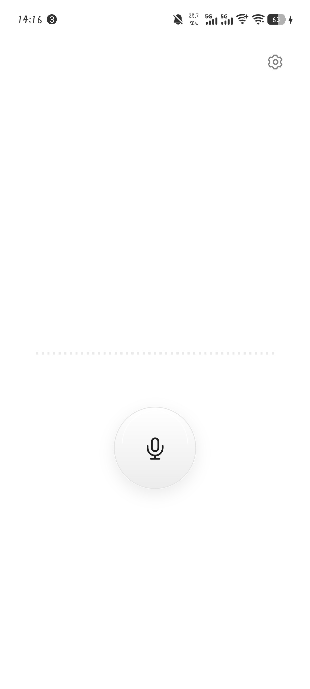
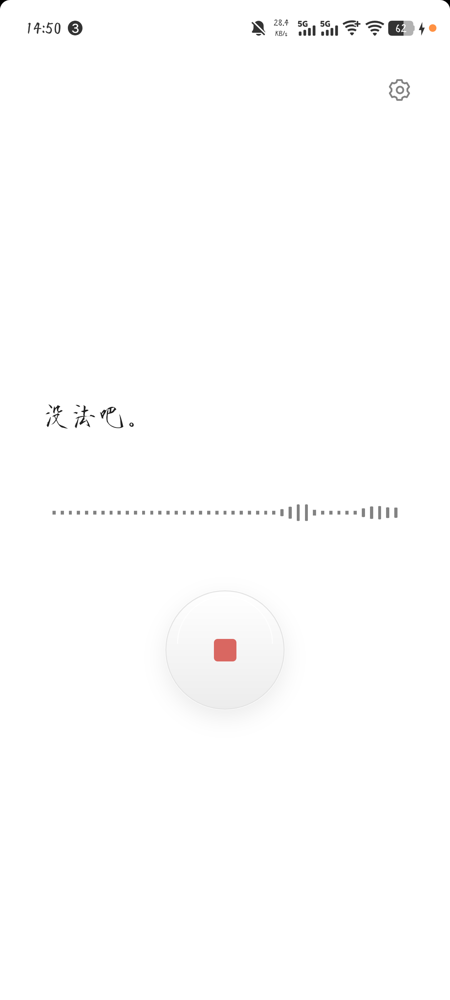
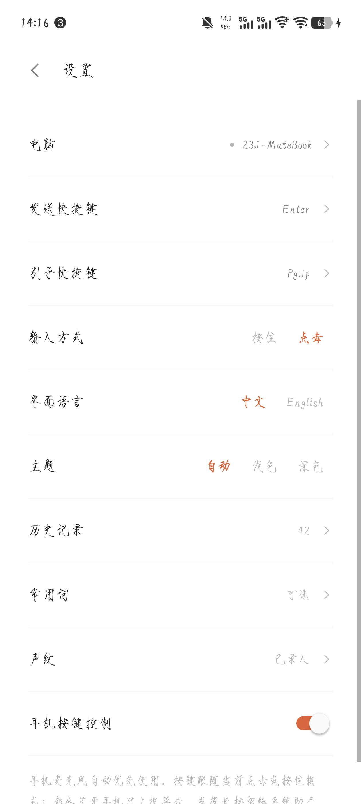
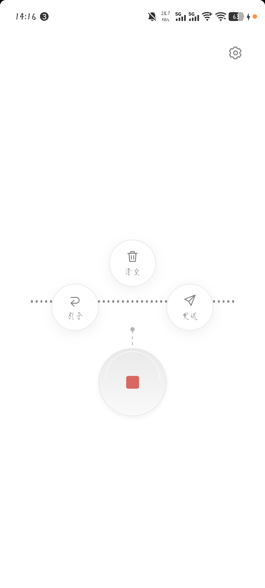
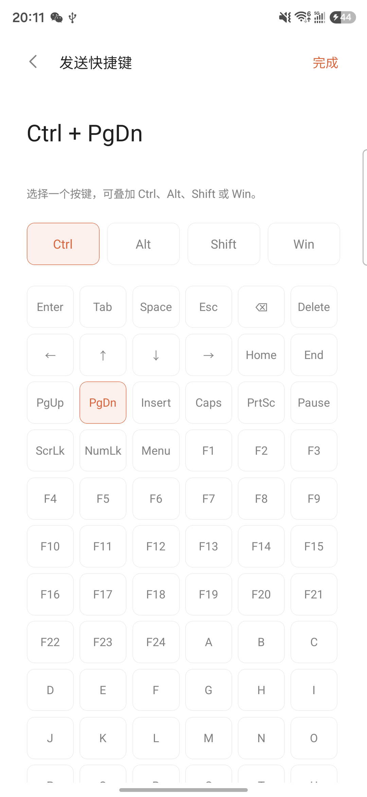
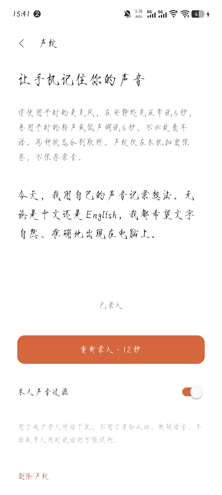
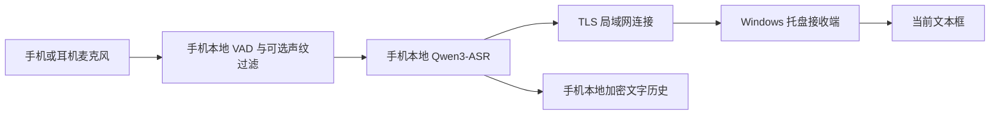

<p align="center">
  
</p>

<h1 align="center">PhoneMIC</h1>

<p align="center"><strong>把安卓手机变成电脑的语音输入按钮。</strong></p>

<p align="center">手机离线识别 · 中文 / English / 中英混说 · 局域网输入 Windows · 无需账号和 API Key</p>

<p align="center">
  <a href="https://github.com/23J1633/PhoneMIC/releases"></a>
  <a href="LICENSE"></a>
  
  
</p>

<p align="center">
  <a href="#下载与安装">下载与安装</a> ·
  <a href="#实际界面">实际界面</a> ·
  <a href="docs/usage.md">详细使用说明</a> ·
  <a href="docs/development.md">开发与构建</a> ·
  <a href="https://github.com/23J1633/PhoneMIC/issues">反馈问题</a>
</p>

PhoneMIC 在 Android 手机上运行 Qwen3-ASR-0.6B INT8，把说出的话转换成文字，再通过局域网输入 Windows 当前选中的文本框。声音在手机本地处理，电脑只接收文字和控制指令；也可以使用蓝牙 HID 模式输入英文。

## 实际界面

| 一个按钮开始说话 | 实时文字与波形 | 所有设置集中管理 |
| :---: | :---: | :---: |
|  |  |  |

以上均为此前保存的真机截图，字体随手机系统设置变化。查看 [完整截图集](docs/screenshots/README.md)，包含首页、录音反馈、动作拖选、声纹、快捷键与历史记录。

## 为什么使用 PhoneMIC

| 功能 | 使用体验 |
| --- | --- |
| 本机离线识别 | APK 内置模型、分词器和运行库，安装后无需再下载模型，无需登录或配置 API Key |
| 中英混说 | 自动识别中文、英文及同一句话中的中英混合，支持常用词提示 |
| 两种输入方式 | 点击开始／结束，或按住说话、松开确认；按住模式可同步修订电脑中的文字 |
| 结束动作 | 长按结束按钮，拖向“引导”“发送”执行对应快捷键，拖向“清空”丢弃本次录音 |
| 本人声音过滤 | CAM++ 在本机保存多个声纹参考，减少旁人讲话的干扰 |
| 耳机控制 | 自动优先使用有线、USB 或蓝牙耳机麦克风，支持媒体按键和耳机发起的后台录音 |
| 历史与设置 | 最近 200 条加密文字历史，支持复制、再次输入和删除；提供中英文界面及浅色／深色主题 |
| Windows 托盘接收 | 自动发现、记住手机、断线重连和随系统启动，通过原生 Unicode 键盘事件输入，不占用剪贴板 |

## 下载与安装

前往 [最新 Release](https://github.com/23J1633/PhoneMIC/releases/latest)，或直接下载 **v1.1.0**：

| 文件 | 平台 | 大小 | 下载 |
| --- | --- | --- | --- |
| `PhoneMIC-1.1.0-arm64.apk` | Android 9+，ARM64 | 约 886 MiB，含离线模型 | [Android APK](https://github.com/23J1633/PhoneMIC/releases/download/v1.1.0/PhoneMIC-1.1.0-arm64.apk) |
| `PhoneMIC-Desktop.exe` | Windows 10 / 11，x64 | 约 8 MiB | [Windows 接收端](https://github.com/23J1633/PhoneMIC/releases/download/v1.1.0/PhoneMIC-Desktop.exe) |
| `SHA256SUMS.txt` | 下载完整性校验 | — | [SHA-256 校验文件](https://github.com/23J1633/PhoneMIC/releases/download/v1.1.0/SHA256SUMS.txt) |

1. **安装手机端**：安装 APK，允许使用麦克风，等待首次本地模型初始化完成。
2. **启动电脑端**：将 EXE 放在固定目录后双击运行，程序在右下角系统托盘待机，并自动配置随 Windows 启动。新版首次运行会请求管理员权限配置局域网防火墙规则；也可在托盘菜单中查看连接信息或修复局域网连接。
3. **连接电脑**：手机和电脑连到可互访的局域网，在手机“设置 → 电脑”中点选发现的电脑。首次连接自动记住设备，后续自动重连；找不到时可手动输入电脑 IP 或主机名，支持带端口和 IPv6。VPN、跨子网及访客网络的配置见[连接说明](docs/usage.md#vpn多个网卡与中大型局域网)。
4. **开始输入**：在电脑上选中目标文本框，点击手机按钮开始说话，再点一次结束。也可以在设置中切换为按住说话。

安装完成后的语音识别无需互联网。局域网模式需要手机与电脑网络互通；仅在可信局域网中完成首次连接。

<details>
<summary>校验下载文件</summary>

在下载目录中使用 PowerShell：

```powershell
Get-FileHash .\PhoneMIC-1.1.0-arm64.apk -Algorithm SHA256
Get-FileHash .\PhoneMIC-Desktop.exe -Algorithm SHA256
```

将结果与 `SHA256SUMS.txt` 中同名文件的值比较。文件中若带有 `artifacts/` 前缀，它只是构建时的相对路径。

</details>

## 交互细节

**点击模式**适合完整说完后输入。说话时显示文字预览，停顿时确认语句；轻点结束按钮输入文字。长按结束按钮约 0.4 秒，再拖向气泡，可为这次输入选择动作。

| 选择结束动作 | 自定义组合快捷键 | 本地声纹设置 |
| :---: | :---: | :---: |
|  |  |  |

**按住模式**适合边说边输入，识别修订会同步到电脑，松开后确认最终文字。“引导”和“发送”快捷键可分别设置，支持 Ctrl、Alt、Shift、Win、F1–F24 和数字小键盘等按键。

**声纹录入**使用平时的麦克风，在安静处先正常说话 6 秒，再用平时的轻声或低声调说话 6 秒。保存后可启用本人声音过滤，也可重新录入、关闭或删除；声纹在本机加密保存，不保留录音。声纹用于减少干扰，不用于身份认证。

**历史记录**最多保留 200 条文字，可以复制、再次输入电脑或删除。未连接电脑时仍可离线识别并保存文字；输入失败时可在历史中核对后重试。

完整交互、耳机行为和断线处理见 [使用说明](docs/usage.md)。

## 连接方式

| 方式 | 中文 | 英文 | 电脑端要求 |
| --- | --- | --- | --- |
| 局域网 | 支持 | 支持 | 运行 Windows 接收端，手机首次点选后自动重连 |
| 蓝牙 HID | 不支持直接输入中文 | 支持 ASCII | 系统蓝牙配对，无需接收端；手机固件须支持 HID Device |

优先使用局域网获取完整的中英文输入。蓝牙 HID 使用逐键输入，需要电脑采用美式英文键盘布局并关闭大写锁定；部分手机需要保持 PhoneMIC 在前台。

## 数据如何流动



采音、语音识别和声纹处理均在手机完成，不上传声音、不调用远程推理服务。连接使用 TLS，手机保存首次连接时的完整证书指纹；Windows 接收端只接收文字及控制指令。空闲时不打开麦克风，也不持续运行推理；进程存活时缓存已加载模型，减少再次打开时的等待。

## 使用前了解

- **性能**：模型在手机 CPU 上运行，耗时随设备、录音长度和环境变化。界面的 `ms` 是局域网传输往返耗时，不代表完整语音识别延迟。
- **输入焦点**：输入期间保持电脑目标文本框选中；原生窗口或输入控件切换时接收端会中止当前输入。管理员窗口可能需要同等权限，系统安全桌面和受保护控件不保证可用。
- **录音与后台**：单次最长 10 分钟。屏幕按钮发起的录音在切后台时结束；耳机发起的录音可通过已准备好的麦克风前台服务继续，并可从通知结束。
- **耳机与声纹**：蓝牙耳机需要提供通话输入通道，媒体按键行为取决于固件和系统。极短、重叠或不同麦克风下的语音可能被声纹误判。
- **断线**：尚未发送的最终文字最多等待重连 8 秒；已尝试发送但未确认的文字不会自动重放，请在历史中核对。
- **平台**：当前发布 Android ARM64 和 Windows x64；仓库内 `ios/` 为工程骨架，尚无可用的 iOS 版本。

## 开发与贡献

```bash
git clone https://github.com/23J1633/PhoneMIC.git
cd PhoneMIC
npm ci
npm run typecheck
npm run lint -- --quiet
npm test -- --runInBand
```

技术栈为 React Native / TypeScript、Android Kotlin 和 Go。模型下载、Android 签名与构建、Windows 编译和测试方式见 [开发文档](docs/development.md)。模型及安装包不存入 Git，发布产物通过 Release 提供。

欢迎提交 [Issue](https://github.com/23J1633/PhoneMIC/issues) 和 Pull Request。报告问题时请附上版本、手机型号、系统版本、连接方式和复现步骤。提交代码前运行上述检查；涉及接收端时，同时运行 `companion/` 下的 Go 测试。

## 开源许可与致谢

PhoneMIC 原创代码以 [MIT License](LICENSE) 开源。模型与第三方组件遵循各自许可证，详见 [THIRD_PARTY_NOTICES.md](THIRD_PARTY_NOTICES.md) 和 [随 APK 提供的许可证文本](android/app/src/main/assets/licenses/)。

感谢 [Qwen3-ASR](https://github.com/QwenLM/Qwen3-ASR)、[sherpa-onnx](https://github.com/k2-fsa/sherpa-onnx)、[Silero VAD](https://github.com/snakers4/silero-vad)、[3D-Speaker](https://github.com/modelscope/3D-Speaker)、[React Native](https://github.com/facebook/react-native) 及其依赖项目。
