# 真机截图集

返回 [项目首页](../../README.md)。以下图片整理自项目此前保存的真机截图，保留原图。截图来自不同测试阶段与设备，字体随手机系统设置变化；当前声纹录入流程以 12 秒版本及 [使用说明](../usage.md) 为准。

## 首页与录音

| 首页 | 录音反馈 | 点击模式 |
| :---: | :---: | :---: |
| 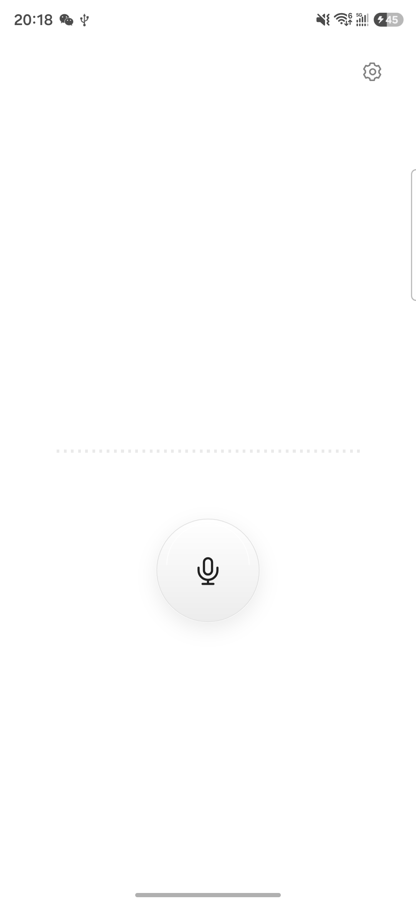 | 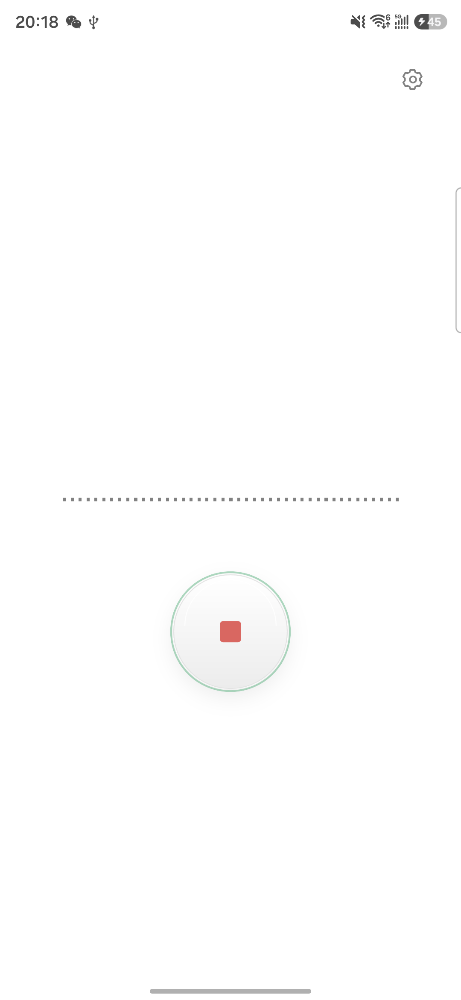 | 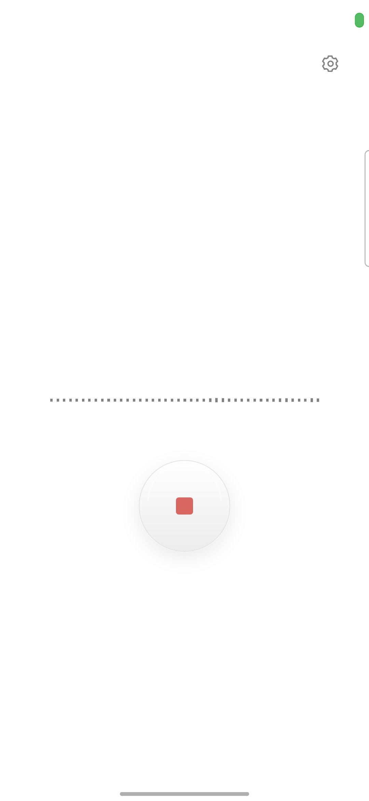 |

| 实时输入首页 | 录音中波形 | 停止瞬间 |
| :---: | :---: | :---: |
| 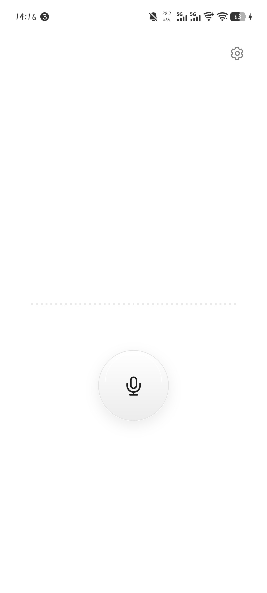 | 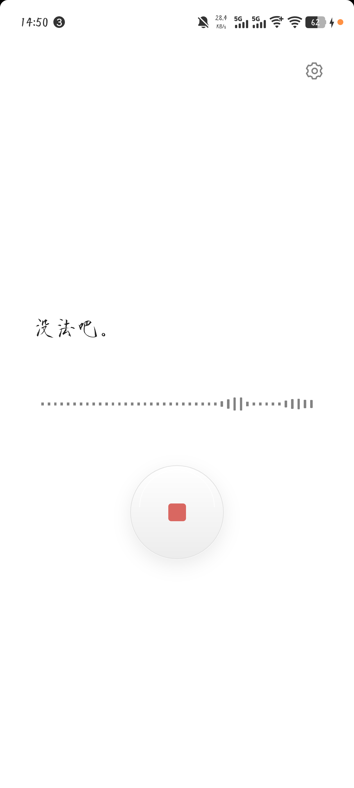 | 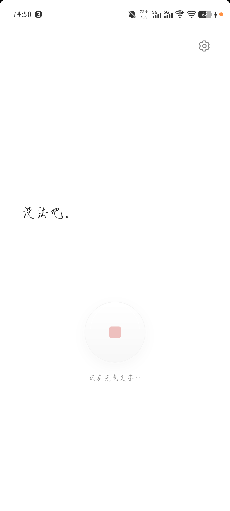 |

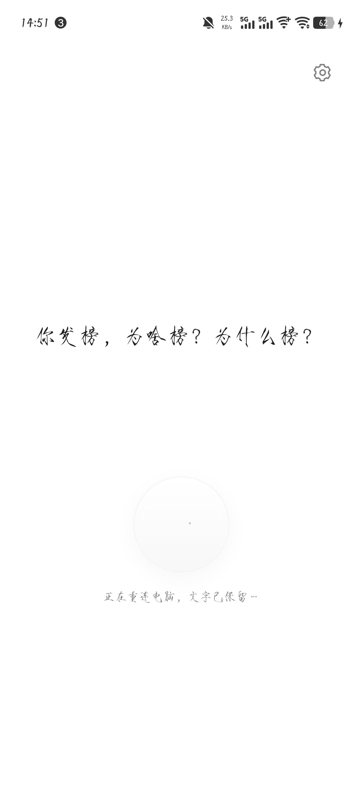 停止录音三秒后的首页

## 结束动作

| 选择动作 | 引导 | 发送 | 清空 |
| :---: | :---: | :---: | :---: |
| 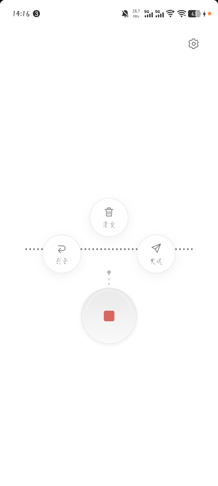 | 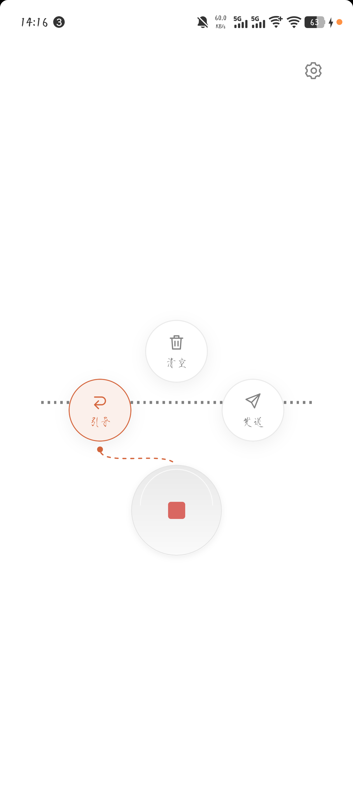 | 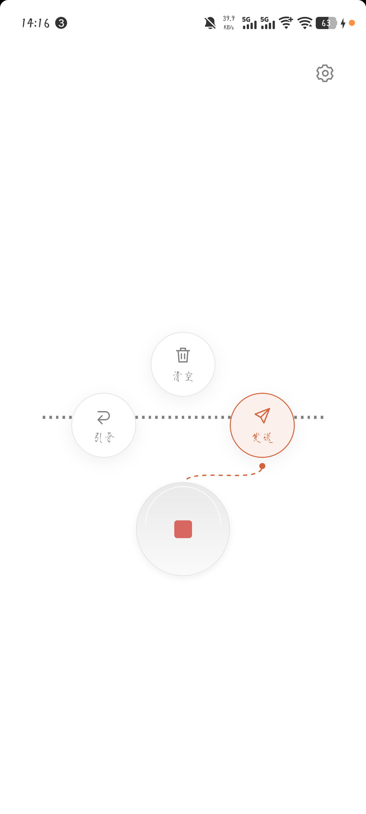 | 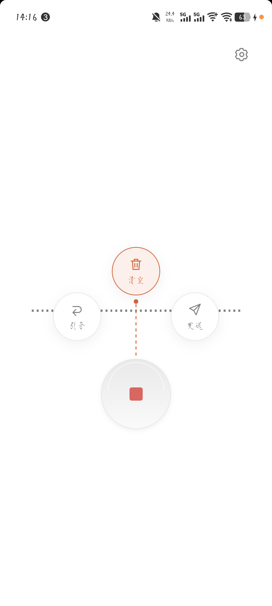 |

## 设置、快捷键与历史

| 设置 | 实时输入设置 | 快捷键 | 历史记录 |
| :---: | :---: | :---: | :---: |
| 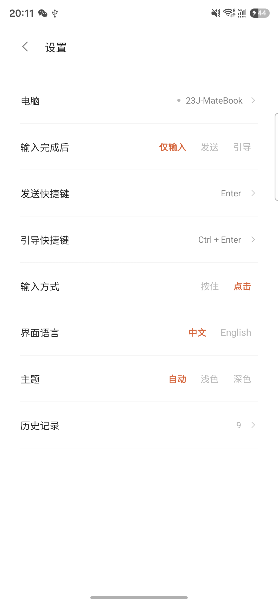 | 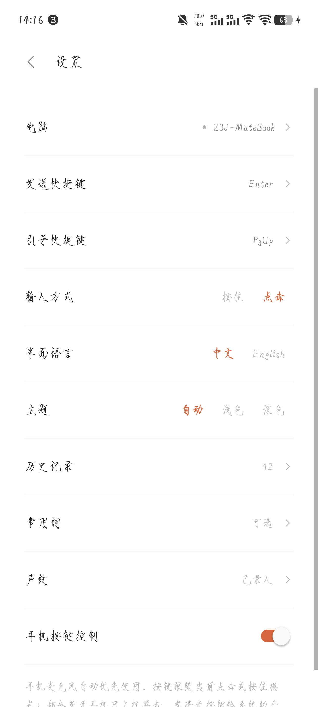 | 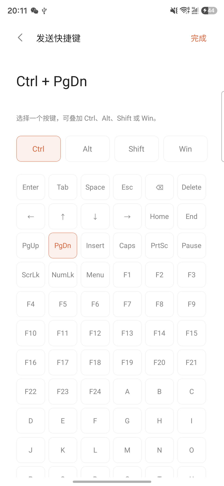 | 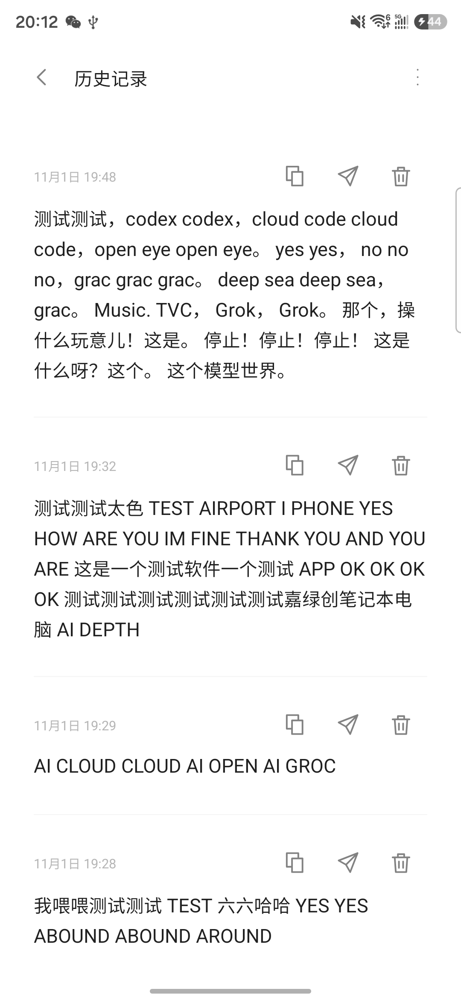 |

## 声纹

| 当前声纹设置：12 秒分阶段录入 | 早期录入界面 |
| :---: | :---: |
| 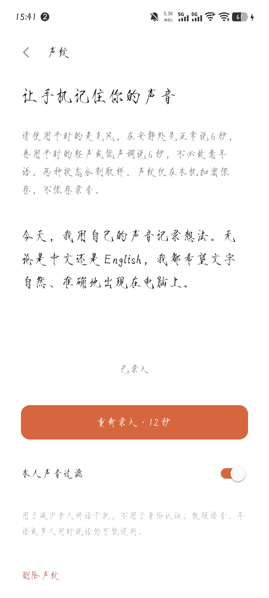 | 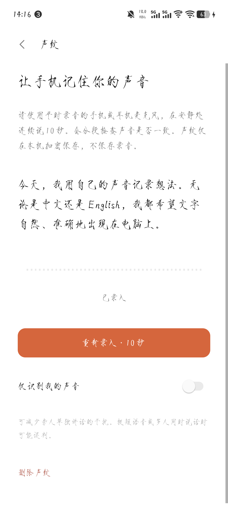 |

## 应用图标

